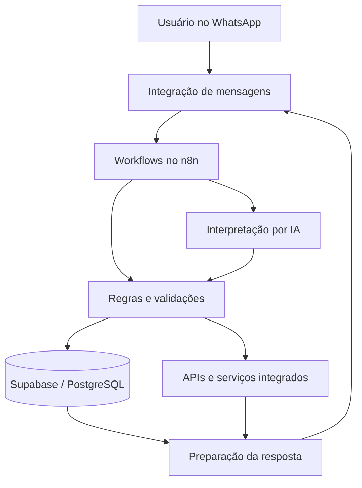

# MEU CONSULTOR AI

### Inteligência Artificial aplicada à automação de processos e à construção de produtos digitais

**Projeto autoral | SaaS em desenvolvimento | Integrações e automações via WhatsApp**

> Este repositório apresenta a visão do produto, decisões de arquitetura, fluxos demonstráveis e aprendizados do desenvolvimento do MEU CONSULTOR. Não é uma publicação integral do código ou da infraestrutura de produção.

## Visão geral

O **MEU CONSULTOR** é um projeto de produto digital que explora o uso de inteligência artificial e automação para simplificar atividades operacionais e organizar informações por meio de uma interface conversacional no WhatsApp.

O desenvolvimento reúne configuração de workflows, integração entre serviços, persistência de dados e desenho de experiências orientadas a tarefas. O objetivo é transformar solicitações em linguagem natural em ações rastreáveis e úteis para o usuário.

## Problema e proposta de valor

A execução de tarefas cotidianas frequentemente depende de múltiplas ferramentas, registros manuais e consultas repetitivas. O MEU CONSULTOR investiga como reduzir essa fragmentação com uma experiência conversacional integrada a automações e dados estruturados.

**Proposta:** permitir que o usuário solicite ações pelo WhatsApp, enquanto fluxos de automação processam a intenção, consultam ou atualizam dados e retornam uma resposta adequada.

## Tecnologias e componentes do projeto

| Tecnologia / componente | Papel no projeto |
| --- | --- |
| **WhatsApp** | Interface conversacional de interação com o usuário |
| **n8n** | Orquestração de workflows e integrações |
| **Supabase / PostgreSQL** | Persistência e consulta de dados estruturados |
| **Modelos de linguagem (LLMs)** | Interpretação de solicitações e apoio à execução de tarefas |
| **APIs e webhooks** | Comunicação entre serviços e disparo de processos |
| **GitHub** | Documentação, versionamento e apresentação técnica do projeto |

> A presença de uma tecnologia nesta tabela não significa domínio avançado de todos os seus recursos. As competências são evidenciadas por implementações e registros documentados.

## Arquitetura conceitual

*Diagrama conceitual para comunicação da solução; não representa necessariamente cada nó ou conexão da implantação atual.*

## Casos de uso e estágio de evolução

| Caso de uso | Evidência disponível no histórico do projeto | Situação de documentação |
| --- | --- | --- |
| **Solicitação de agendamentos pelo WhatsApp** | Fluxos de criação e confirmação trabalhados durante o desenvolvimento | Documentar testes de ponta a ponta e comportamento atual |
| **Consulta de agenda** | Cenários de consulta e inconsistências identificadas em testes | Registrar correções e validação antes de declarar concluído |
| **Registro de informações em banco de dados** | Configurações e operações SQL/Supabase exploradas no projeto | Publicar exemplos anonimizados e verificáveis |
| **Gestão financeira** | Funcionalidade considerada na proposta do produto | Confirmar e documentar o estágio efetivo de implementação |
| **Multiempresa / multiusuário** | Requisito de arquitetura discutido no planejamento | Validar implementação e isolamento antes de anunciar como funcionalidade pronta |
| **Emissão de documentos fiscais** | Possibilidade analisada no roadmap | Planejamento; não apresentada como funcionalidade implementada |

## Minha atuação no projeto

Minha atuação no MEU CONSULTOR envolve a concepção do produto, a definição de casos de uso, a configuração e evolução de automações, o acompanhamento de integrações e a investigação de problemas encontrados em testes.

O projeto é também um ambiente de aprendizado aplicado: decisões são refinadas conforme a viabilidade técnica, a experiência do usuário, a segurança e os custos de operação.

### Competências evidenciadas pelo trabalho

- **Pensamento de produto:** transformar necessidades em funcionalidades e fluxos de uso.
- **Automação de processos:** estruturar e depurar workflows orientados a eventos.
- **Integração de sistemas:** conectar canais conversacionais, serviços e armazenamento de dados.
- **Aplicação prática de IA:** explorar interpretação de linguagem natural em processos operacionais.
- **Resolução de problemas:** investigar falhas, testar hipóteses e ajustar fluxos.
- **Documentação técnica:** registrar arquitetura, limitações, decisões e evolução.

### Competências em desenvolvimento ou validação

- Segurança e governança de aplicações SaaS multiusuário.
- Observabilidade, testes automatizados e confiabilidade operacional.
- Controle de custos, latência e qualidade de sistemas com LLMs.
- Arquitetura escalável e práticas de engenharia para produção.

## Decisões e aprendizados

O projeto reforça a importância de:

1. Separar interpretação de linguagem natural de operações críticas sobre dados.
2. Validar entradas e permissões antes de executar ações.
3. Confirmar persistência de registros antes de comunicar sucesso ao usuário.
4. Testar separadamente criação, consulta, atualização e confirmação de agendamentos.
5. Tratar privacidade, segregação de dados e custos como requisitos de produto.

Esses pontos são princípios de projeto e áreas de trabalho contínuo, não garantias de que todos os controles já estejam implantados.

## Roadmap de documentação

- [ ] Publicar um diagrama revisado da arquitetura efetivamente implantada.
- [ ] Documentar um fluxo de agendamento testado de ponta a ponta.
- [ ] Incluir capturas de tela com dados sensíveis ocultados.
- [ ] Registrar decisões técnicas, alternativas e trade-offs.
- [ ] Criar casos de estudo com problema, solução, evidência e resultado.
- [ ] Acrescentar indicadores reais de qualidade, custos ou desempenho quando disponíveis.

## Segurança e escopo público

Este é um **repositório de apresentação técnica e documentação**. Credenciais, tokens, chaves de API, dados de clientes, identificadores privados e configurações de produção não devem ser publicados. Exemplos de workflows devem ser revisados e anonimizados antes de qualquer compartilhamento.

## Sobre o projeto

O MEU CONSULTOR combina aprendizado aplicado, desenvolvimento de produto e experimentação com inteligência artificial para resolver problemas concretos por meio de automação e interfaces conversacionais.

**Foco profissional:** IA aplicada, automação de processos, integrações, soluções SaaS e desenvolvimento de produtos digitais.

---

*Documentação em evolução. Os estágios de implementação serão atualizados conforme cada funcionalidade for validada e puder ser demonstrada.*
