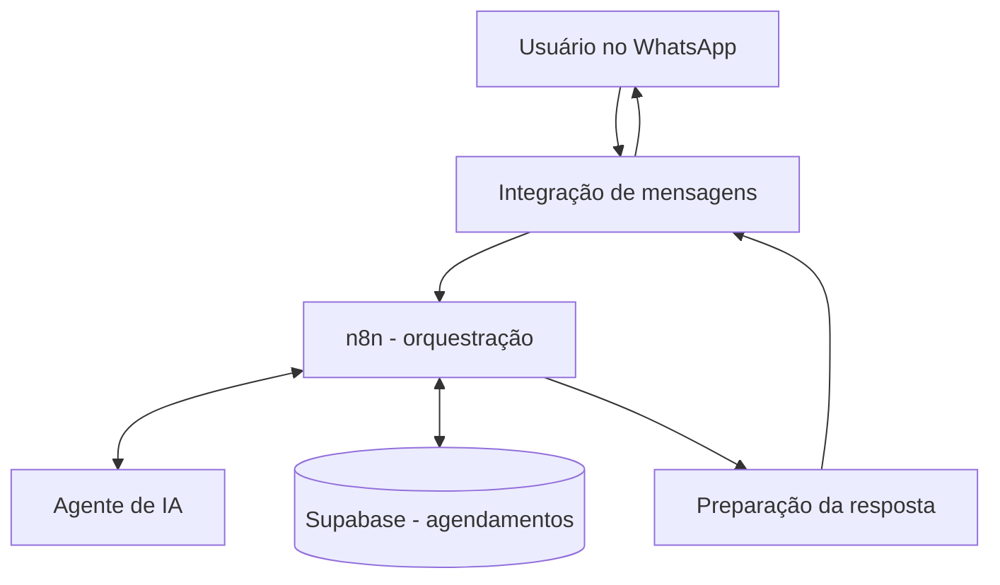

# Case técnico 01 — Agendamentos inteligentes pelo WhatsApp

> **Status:** fluxo de criação e consulta funcional, conforme testes relatados pela pessoa responsável pelo projeto. Este documento descreve o comportamento confirmado; não representa auditoria independente nem certificação de produção.

## 1. Contexto e problema

Agendar compromissos e consultar a própria agenda pode exigir alternar entre aplicativos e preencher formulários. O **MEU CONSULTOR** utiliza uma interface conversacional no WhatsApp para transformar pedidos em linguagem natural em registros estruturados que podem ser consultados posteriormente.

## 2. Objetivo

Permitir que uma pessoa:

1. Solicite um agendamento por mensagem no WhatsApp.
2. Receba o processamento da solicitação por uma automação com agente de IA.
3. Tenha o compromisso registrado no Supabase.
4. Consulte sua agenda pelo WhatsApp e recupere o compromisso salvo.

## 3. Tecnologias envolvidas

| Componente | Papel no fluxo |
| --- | --- |
| WhatsApp | Canal conversacional para solicitações e respostas |
| n8n | Orquestração das etapas e integrações |
| Agente de IA | Interpretação da intenção e dos dados da mensagem |
| Supabase | Persistência e consulta dos registros de agendamento |

A implementação específica do provedor de WhatsApp, do modelo de IA, dos nós do n8n e das políticas de acesso ao banco ainda precisa ser documentada com evidências técnicas.

## 4. Arquitetura lógica

> **Nota:** o diagrama representa responsabilidades e conexões lógicas, não necessariamente a ordem exata de cada nó ou chamada no workflow real.

## 5. Cenário A — Criação de agendamento

**Exemplo ilustrativo de mensagem:**

> Agende uma terapia amanhã às 17h.

**Comportamento funcional confirmado:** a solicitação chega pelo WhatsApp, é processada pela automação com IA e n8n e resulta no registro do compromisso no Supabase. A interação de resposta é realizada pelo canal conversacional.

**Pontos a detalhar em uma revisão futura:** interpretação de datas relativas, fuso horário, confirmação do usuário, prevenção de duplicidade, tratamento de erros e regras de autorização.

## 6. Cenário B — Consulta da agenda

**Exemplo ilustrativo de mensagem:**

> Qual é minha agenda de amanhã?

**Comportamento funcional confirmado:** a solicitação é processada e o compromisso anteriormente salvo pode ser recuperado do Supabase e apresentado na conversa pelo WhatsApp.

**Pontos a detalhar:** filtro por usuário, intervalo de datas, tratamento de agenda vazia e regras de privacidade.

## 7. Validação funcional

| Verificação | Estado |
| --- | --- |
| Receber solicitação de agendamento no WhatsApp | Confirmado pelo responsável |
| Processar solicitação via n8n e agente de IA | Confirmado pelo responsável |
| Gravar compromisso no Supabase | Confirmado pelo responsável |
| Consultar agenda pelo WhatsApp | Confirmado pelo responsável |
| Recuperar compromisso previamente salvo | Confirmado pelo responsável |
| Testes automatizados e cobertura | Não documentados |
| Testes de carga e disponibilidade | Não documentados |
| Auditoria de segurança e isolamento entre usuários | Não documentados |

## 8. Competências demonstradas pelo trabalho

Este caso documenta experiência prática com **automação de processos**, **integração entre serviços**, **fluxos conversacionais com IA**, **persistência e consulta de dados** e **resolução iterativa de problemas técnicos**.

O case não pressupõe domínio avançado de todos os componentes, desenvolvimento integral de cada serviço ou resultados comerciais ainda não comprovados.

## 9. Evidências a acrescentar

- Capturas dos workflows relevantes do n8n, com credenciais, URLs privadas, identificadores e dados pessoais ocultados.
- Exemplo anonimizado de solicitação, confirmação e consulta no WhatsApp.
- Exemplo de registro anonimizado ou sintético no Supabase.
- Descrição do defeito identificado durante os testes e da correção aplicada, quando verificada.
- Data e ambiente de execução dos testes, sem revelar informações sensíveis.

## 10. Próximas melhorias a avaliar

- Tratamento explícito de fuso horário e datas relativas.
- Confirmação e idempotência dos agendamentos.
- Regras de autenticação, autorização e isolamento de registros.
- Logs seguros, monitoramento e tratamento de falhas.
- Testes automatizados para criação, consulta e cenários de erro.

---

**Projeto:** MEU CONSULTOR AI  
**Tipo de documento:** estudo de caso técnico, baseado em funcionalidades relatadas como operacionais  
**Escopo:** agendamentos via WhatsApp com n8n, IA e Supabase
