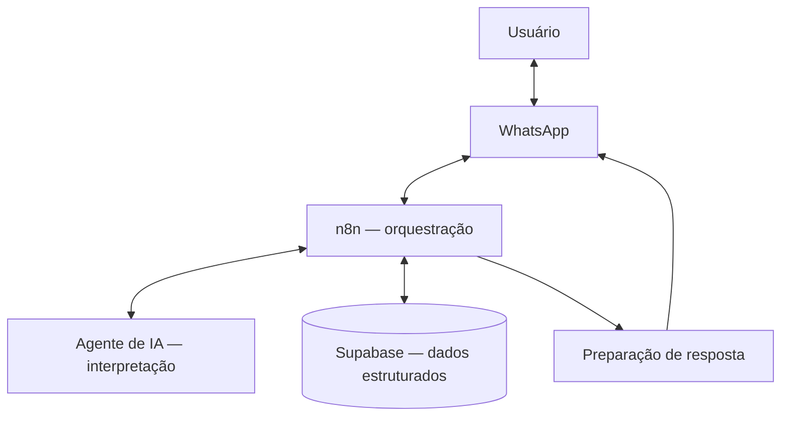

# Arquitetura técnica — MEU CONSULTOR AI

> **Status:** documentação inicial de uma integração funcional, conforme validação informada pelo responsável pelo projeto. Este documento não representa auditoria de segurança nem certificação de prontidão para produção.

## 1. Visão geral

O **MEU CONSULTOR** é um produto digital que utiliza uma interface conversacional pelo WhatsApp para receber solicitações, processá-las em fluxos automatizados e consultar ou registrar informações estruturadas.

O fluxo principal já está funcional: **mensagens do WhatsApp são processadas no n8n, passam por integração com agente de IA e podem gerar gravações e consultas no Supabase**.

## 2. Diagrama conceitual

**Nota:** o desenho é uma abstração didática, não um diagrama fiel de todos os nós, serviços intermediários, gatilhos ou protocolos. A integração específica com WhatsApp e o provedor de modelo de IA ainda serão identificados na documentação detalhada.

## 3. Responsabilidades dos componentes

| Componente | Responsabilidade documentada | Evidência a anexar |
|---|---|---|
| WhatsApp | Interface de entrada e saída de mensagens | Captura anonimizada de conversa de teste |
| n8n | Receber eventos e orquestrar workflows | Captura do fluxo sem credenciais ou dados pessoais |
| Agente de IA | Interpretar solicitações em linguagem natural | Exemplo de entrada e saída anonimizado |
| Supabase | Persistir e consultar dados | Esquema simplificado e teste anonimizado de leitura/gravação |

## 4. Sequência funcional observada/informada

1. Uma pessoa envia uma solicitação pelo WhatsApp.
2. A mensagem é encaminhada ao fluxo automatizado no n8n.
3. O fluxo utiliza um agente de IA para interpretar a solicitação quando necessário.
4. O workflow executa ações apropriadas, incluindo consultas ou gravações no Supabase.
5. O sistema prepara e envia uma resposta pelo canal conversacional.

O comportamento de cada intenção, os mecanismos de confirmação e os cenários de falha devem ser descritos separadamente com testes reproduzíveis.

## 5. Casos de uso para documentação progressiva

- **Agendamentos:** registrar um compromisso e recuperá-lo por consulta posterior. **Estado detalhado:** requer teste ponta a ponta documentado.
- **Consultas a dados estruturados:** recuperar registros persistidos. **Estado detalhado:** integração geral confirmada; regras de autorização ainda a documentar.
- **Gestão financeira:** caso de uso em evolução; não declarar como validado sem evidência específica.
- **Multiempresa/multiusuário:** objetivo arquitetural; não afirmar isolamento efetivo sem inspeção de políticas e testes de RLS.

## 6. Segurança e privacidade

**Nunca publicar neste repositório:** tokens de acesso, chaves de API, credenciais de banco, dados reais de clientes, telefones, payloads identificáveis, URLs privadas ou exports de workflows contendo segredos.

Pontos de verificação antes de qualquer afirmação de segurança:

- Identificação e autenticação de origem das mensagens e webhooks.
- Autorização por usuário e, se aplicável, por empresa.
- Políticas de Row Level Security (RLS) e testes de isolamento entre usuários/empresas.
- Gestão de segredos, privilégios mínimos e políticas de acesso ao Supabase.
- Logs com minimização de dados pessoais, retenção e mecanismos de exclusão.
- Tratamento de erros, repetição de eventos, idempotência e prevenção de gravações duplicadas.
- Adequação à LGPD conforme os dados efetivamente tratados.

## 7. Evidências e critérios de validação

| Teste | Resultado atual | Próxima evidência |
|---|---|---|
| Mensagem recebida no WhatsApp chega ao n8n | Confirmado pelo responsável | Print anonimizado do gatilho |
| Agente de IA processa solicitações | Confirmado pelo responsável | Execução de teste anonimizada |
| n8n grava dados no Supabase | Confirmado pelo responsável | Registro de teste sem dados reais |
| n8n consulta dados no Supabase | Confirmado pelo responsável | Resultado de consulta de teste |
| Permissões e isolamento entre empresas | Não verificado | Testes com contas distintas e revisão de RLS |
| Recuperação de falhas e observabilidade | Não verificado | Cenários de falha e logs redigidos |

## 8. Decisões de produto e engenharia

A separação entre **interface conversacional**, **orquestração**, **interpretação por IA** e **persistência de dados** facilita documentar responsabilidades e evoluir funcionalidades de maneira incremental. Isso não implica, por si só, alta disponibilidade, escalabilidade ou segurança comprovada.

A documentação pública prioriza arquitetura conceitual, decisões técnicas e exemplos reproduzíveis, preservando os detalhes sensíveis da operação.

## 9. Próximas etapas

1. Identificar a integração exata utilizada com o WhatsApp e o provedor/modelo de IA.
2. Criar um estudo de caso ponta a ponta de agendamento, com evidências anonimizadas.
3. Mapear as principais tabelas e relacionamentos do Supabase sem expor dados reais.
4. Documentar tratamento de erros, autenticação, autorização e proteção de dados.
5. Validar separadamente funcionalidades financeiras e requisitos multiempresa.

---

**Escopo desta versão:** documentar fielmente o fluxo principal funcional e explicitar os aspectos ainda não comprovados.
