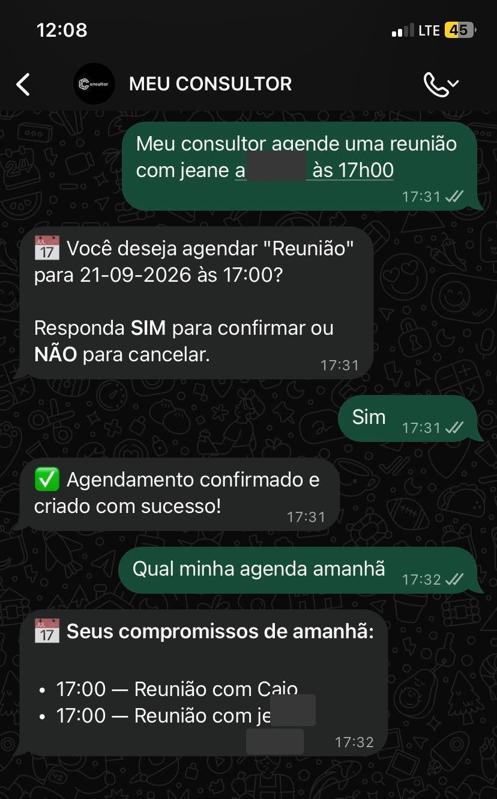
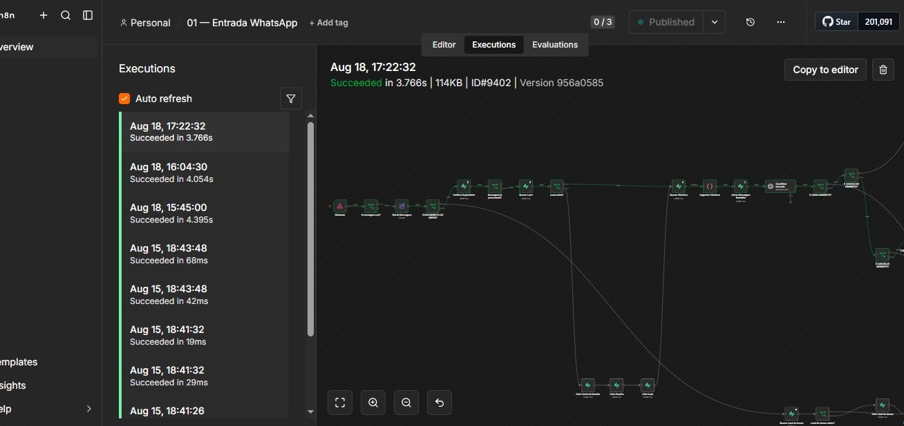
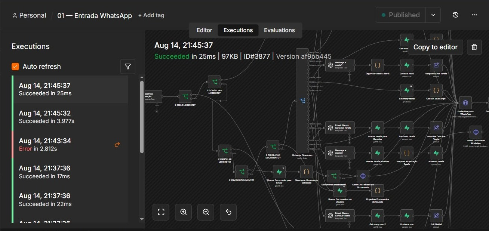
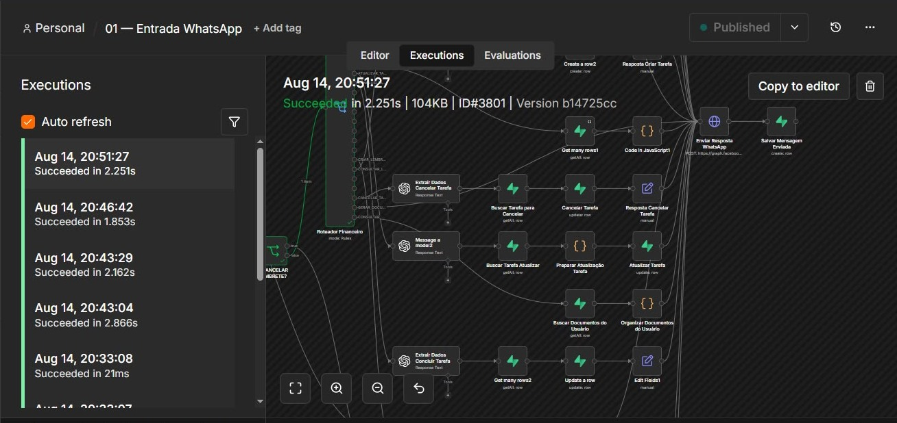
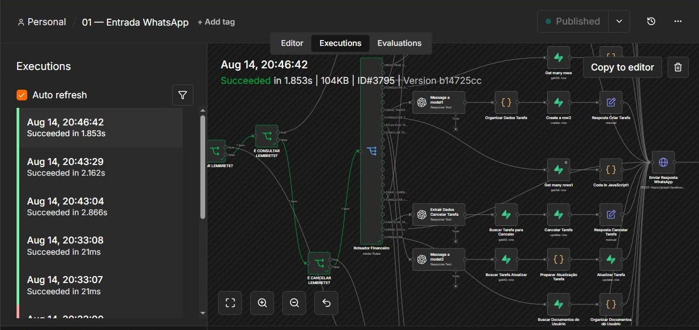
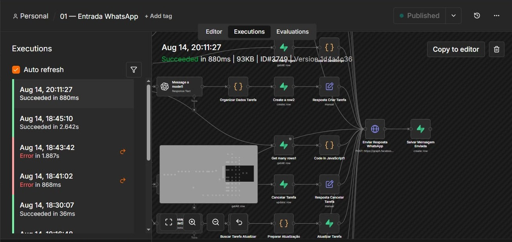
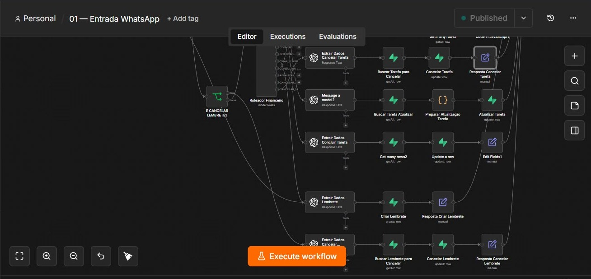
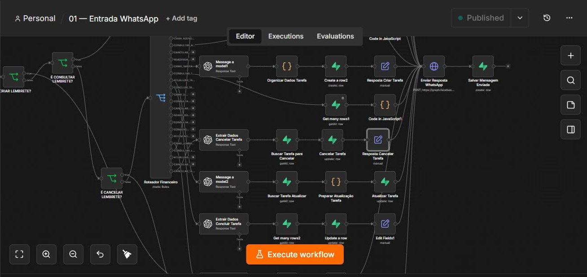

# Evidências técnicas — MEU CONSULTOR AI

## 1. Visão geral

O MEU CONSULTOR AI é um projeto de assistente inteligente integrado ao WhatsApp, desenvolvido com automações no n8n, agentes de inteligência artificial e persistência de dados no Supabase.

Este diretório reúne evidências visuais de implementação, testes e execução de diferentes funcionalidades do projeto.

As capturas representam etapas específicas do desenvolvimento e não constituem, isoladamente, comprovação de funcionamento de todas as funcionalidades em produção.

## 2. Interface conversacional no WhatsApp

### Apresentação do assistente

Demonstra a interface conversacional utilizada para apresentar as funcionalidades do assistente aos usuários.

### Agendamento e consulta

Demonstra um teste de agendamento com solicitação em linguagem natural, confirmação explícita e consulta posterior dos compromissos.

**Funcionalidades demonstradas:** interpretação de solicitações, confirmação de agendamento e recuperação de informações.

## 3. Orquestração e execução no n8n

### Execução 9402

Registro de execução bem-sucedida do workflow principal, demonstrando a orquestração visual de etapas automatizadas.

### Execução 3877

Evidência de execução e de ramificações relacionadas a tarefas, documentos e processamento de mensagens.

### Execução 3801

Demonstra operações de consulta, atualização e cancelamento de tarefas, além da preparação de respostas.

### Execução 3795

Apresenta roteamento de intenções e integração entre componentes de inteligência artificial e operações de dados.

### Execução 3749

Evidencia a integração entre processamento de tarefas, operações de dados e envio de respostas pelo WhatsApp.

## 4. Integrações e componentes técnicos

### Webhook e anexos

Apresenta etapas de recebimento de mensagens, identificação de anexos e processamento inicial das solicitações.

### Agente de agenda

Demonstra a estrutura de automação responsável por interpretar solicitações relacionadas à agenda e encaminhá-las às operações correspondentes.

### Tarefas e lembretes

Apresenta operações de criação, consulta, atualização e cancelamento de tarefas e lembretes.

### Roteamento de tarefas

Demonstra a distribuição de solicitações entre diferentes caminhos de execução, conforme a intenção identificada.

## 5. Competências técnicas evidenciadas

- Orquestração de workflows utilizando n8n.
- Integração de sistemas por webhooks e APIs.
- Desenvolvimento de interfaces conversacionais pelo WhatsApp.
- Integração de modelos de inteligência artificial em processos automatizados.
- Estruturação de operações de leitura, criação e atualização de dados.
- Implementação de fluxos condicionais e confirmação de ações.
- Análise de execuções, identificação de erros e validação de fluxos.
- Documentação de arquitetura e apresentação de evidências técnicas.

## 6. Limitações e segurança

As imagens representam registros de desenvolvimento e testes em momentos específicos.

Os status de execução bem-sucedida demonstram que os caminhos registrados foram executados sem erro reportado pelo n8n, mas não substituem testes automatizados, auditorias de segurança ou validações de desempenho.

Antes da publicação, as capturas devem ser revisadas para evitar exposição de credenciais, tokens, identificadores internos, URLs sensíveis e dados pessoais.

## 7. Documentação complementar

Consulte também:

- [Arquitetura técnica](../docs/arquitetura.md)
- [Case técnico de agendamentos](../case-studies/agendamentos-whatsapp.md)

---

**MEU CONSULTOR AI — Portfólio técnico de automação, inteligência artificial e integração de sistemas.**
